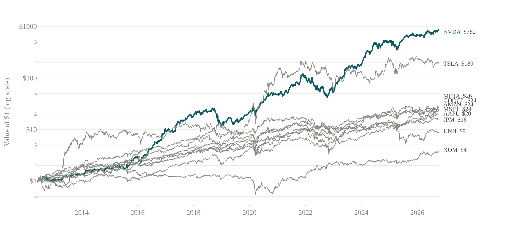
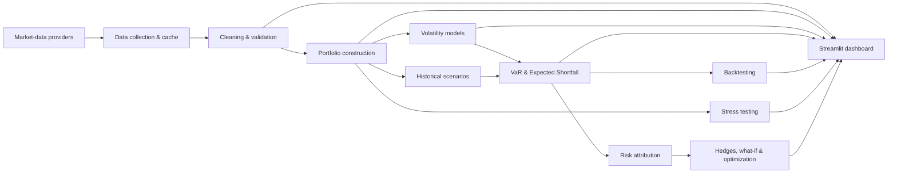

# Advanced Equity Portfolio Risk Management Engine

[](https://advanced-equity-portfolio-risk-management-engine-wklfc8omercko.streamlit.app/)
[](https://github.com/Ma-Mar-Itan/Advanced-Equity-Portfolio-Risk-Management-Engine/actions/workflows/tests.yml)
[](https://www.python.org/)
[](https://streamlit.io/)

An end-to-end market-risk platform that turns raw equity prices into portfolio P&L, adaptive volatility forecasts, Value at Risk, Expected Shortfall, model backtests, stress scenarios, and actionable risk decisions.

**[Launch the live Streamlit dashboard →](https://advanced-equity-portfolio-risk-management-engine-wklfc8omercko.streamlit.app/)**



## Why this project exists

A VaR number is only useful when the entire chain behind it is trustworthy. This project therefore treats risk measurement as a complete system:

```text
Market data → Cleaning → Portfolio construction → Volatility models
            → VaR & Expected Shortfall → Backtesting → Stress testing
            → Risk attribution → Decisions
```

The analytics engine is a standalone Python package. Streamlit is only the presentation layer, so every calculation can be tested, reused in scripts, or integrated into another application without depending on the dashboard.

## What the engine does

| Area | Capability |
|---|---|
| Data | Yahoo Finance, Stooq, Alpha Vantage, Polygon and Tiingo adapters; local caching and offline snapshots |
| Cleaning | Adjusted prices, calendar alignment, missing-value rules, stale-price detection, winsorization and log returns |
| Portfolio | Equal, custom, market-cap and inverse-volatility weights; long-short support; scheduled rebalancing and trading costs |
| Volatility | Rolling volatility, EWMA, GARCH(1,1) and asymmetric GJR-GARCH |
| Tail risk | Historical Simulation and volatility-scaled VaR/ES at multiple confidence levels, windows and horizons |
| Validation | Rolling out-of-sample forecasts, Kupiec POF, Christoffersen independence and conditional coverage |
| Regulation | Basel-style green, yellow and red traffic-light classification |
| Stress | 2008, COVID-19, inflation, banking and technology episodes plus market, sector, volatility and correlation shocks |
| Decisions | Stock and sector risk attribution, diversification benefit, hedge candidates, what-if trades and portfolio optimization |
| Exports | Downloadable chart images and CSV datasets throughout the dashboard |

## Dashboard tour

The dashboard follows the same order as the risk pipeline:

1. **Data** — choose the universe, provider, benchmark, currency and date range.
2. **Cleaning** — inspect missing observations, stale prices, return transformations and rolling volatility.
3. **Portfolio** — set weights, capital, rebalancing and costs; review value, P&L, returns and drawdown.
4. **Volatility** — compare Rolling, EWMA, GARCH and GJR-GARCH estimates, forecasts and diagnostics.
5. **VaR & ES** — measure current and rolling tail risk across models, confidence levels and horizons.
6. **Backtesting** — compare forecasts with realized losses and run statistical coverage tests.
7. **Stress** — replay historical crises and construct hypothetical market, volatility, correlation and sector shocks.
8. **Risk sources** — identify the stocks and sectors driving VaR and Expected Shortfall.
9. **Decisions** — test trades, evaluate hedges and compare the current allocation with optimized alternatives.

## Model stack

### Historical Simulation

Uses the portfolio's observed return history without imposing a normal distribution. VaR is the selected loss quantile; Expected Shortfall is the average loss beyond that threshold.

### EWMA volatility scaling

Uses an exponentially weighted variance estimate with a configurable memory parameter (default **λ = 0.94**). Recent shocks receive more weight, allowing historical returns to be rescaled to today's risk level.

### GARCH(1,1)

Models volatility clustering: large moves tend to be followed by large moves, and calm periods tend to persist. The fitted model produces conditional volatility and forward forecasts used to scale historical scenarios.

### GJR-GARCH

Extends GARCH with a leverage term. Negative shocks can increase future volatility more than positive shocks of equal size—a common feature of equity markets.

### Backtesting

Each forecast is built only from information available at that date. An exception occurs when the realized loss exceeds VaR. The engine evaluates:

- **Kupiec POF:** is the total exception rate correct?
- **Christoffersen independence:** are exceptions independent rather than clustered?
- **Conditional coverage:** are both the frequency and timing acceptable?
- **Basel traffic light:** does the recent exception count fall in the green, yellow or red zone?

## Code map

### Analytics engines: `riskkit/`

| Path | Responsibility |
|---|---|
| `riskkit/config.py` | Immutable configuration shared by every engine: universe, dates, weights, cleaning, volatility, VaR and stress settings |
| `riskkit/data/collect.py` | Coordinates providers, prices, benchmark data, FX conversion, profiles and risk-free rates |
| `riskkit/data/sources/` | Provider adapters for Yahoo, Stooq, Alpha Vantage, Polygon and Tiingo |
| `riskkit/data/cache.py` | Reads and writes provider caches and seeds them from the versioned offline snapshot |
| `riskkit/data/cleaning.py` | Aligns calendars, fills missing values and detects or handles stale prices |
| `riskkit/data/transforms.py` | Winsorization and optional custom return transformations |
| `riskkit/data/returns.py` | Simple returns, log returns and conversion between them |
| `riskkit/data/validation.py` | Data-quality checks for prices, dates, weights, alignment and finite returns |
| `riskkit/data/pipeline.py` | Runs the cleaning pipeline and returns model-ready price and return matrices |
| `riskkit/portfolio/weights.py` | Equal, custom, market-cap and inverse-volatility weights plus rebalance schedules |
| `riskkit/portfolio/construction.py` | Simulates holdings, turnover, costs, value, daily returns, P&L and weight drift |
| `riskkit/portfolio/performance.py` | Annual return, volatility, Sharpe ratio and benchmark comparison |
| `riskkit/portfolio/drawdown.py` | Drawdown series, maximum drawdown and recovery episodes |
| `riskkit/volatility/rolling.py` | Fixed-window rolling volatility |
| `riskkit/volatility/ewma.py` | EWMA variance recursion and forecasts |
| `riskkit/volatility/garch.py` | GARCH/GJR-GARCH fitting, filtering, parameters and news-impact curves |
| `riskkit/volatility/analysis.py` | Fits all models, scales returns, detects band exceptions and studies regimes/leverage |
| `riskkit/var/historical.py` | Historical loss conversion and core VaR/ES calculations |
| `riskkit/var/models.py` | Volatility-scaled scenario generation without look-ahead bias |
| `riskkit/var/engine.py` | Current, rolling and multi-horizon VaR/ES plus confidence/window grids |
| `riskkit/var/checks.py` | Sanity checks such as positive loss values and VaR/ES ordering |
| `riskkit/backtest/tests.py` | Kupiec, Christoffersen independence and conditional-coverage tests |
| `riskkit/backtest/traffic_light.py` | Basel-style zone limits and rolling traffic-light history |
| `riskkit/backtest/compare.py` | Exception tables, model metrics, rankings and comparison summaries |
| `riskkit/stress/historical.py` | Replays crisis periods on today's portfolio and calculates stressed VaR/ES |
| `riskkit/stress/hypothetical.py` | Market, sector, custom, volatility and correlation shocks |
| `riskkit/stress/engine.py` | Runs and ranks the complete stress library |
| `riskkit/attribution/scenarios.py` | Builds aligned asset and portfolio loss scenarios |
| `riskkit/attribution/euler.py` | Component VaR/ES, sector attribution, active risk and diversification benefit |
| `riskkit/decisions/whatif.py` | Evaluates proposed trades before execution |
| `riskkit/decisions/hedge.py` | Searches hedge instruments and hedge sizes |
| `riskkit/decisions/optimize.py` | Minimum-ES and minimum-volatility portfolio optimization |

### Streamlit application: `app/`

| Path | Responsibility |
|---|---|
| `app/app.py` | Application entry point and nine-page navigation |
| `app/state.py` | Cached bridge between dashboard controls and the analytics package |
| `app/controls.py` | Shared portfolio and model inputs |
| `app/views/` | One module for each dashboard page |
| `app/charts/` | Plotly figure builders grouped by risk domain |
| `app/components/kit.py` | Reusable layout, KPI, table, legend and chart-download components |
| `app/components/data_outputs.py` | Clean price, return and portfolio-series download panels |
| `app/assets/style.css` | Dashboard visual system |

### Tests and supporting files

```text
tests/                 Unit and integration tests for every engine
data/snapshot/         Versioned offline market-data snapshot
report_assets/         Figures and results used in the project report
tools/                 Reproducible report, presentation and capture utilities
.github/workflows/     Python 3.10 and 3.12 continuous integration
```

## Architecture



`RiskConfig` is the contract connecting the pipeline. Dashboard pages request cached results from `app/state.py`; state functions call `riskkit`, while Plotly builders render the returned data. Financial logic therefore remains outside the interface.

## Quick start

Python 3.10 or newer is required.

```powershell
git clone https://github.com/Ma-Mar-Itan/Advanced-Equity-Portfolio-Risk-Management-Engine.git
cd Advanced-Equity-Portfolio-Risk-Management-Engine

python -m venv .venv
.venv\Scripts\Activate.ps1
python -m pip install --upgrade pip
python -m pip install -e ".[dev,reports]"

streamlit run app/app.py
```

On Windows, double-click **`Start dashboard.bat`** to create the environment, install dependencies and start the application.

## Data and API keys

The default experience works without an API key through Yahoo Finance, Stooq and the bundled offline snapshot. Optional providers can be enabled with environment variables:

```text
ALPHAVANTAGE_API_KEY=
POLYGON_API_KEY=
TIINGO_API_KEY=
```

Copy `.env.example` to `.env` for local configuration. Never commit `.env`, credentials, provider tokens or WRDS configuration. The collection pipeline records the provider actually used when a fallback occurs.

## Run the tests

The suite is deterministic and does not require network access:

```powershell
python -m pytest
```

Coverage includes data alignment, missing and stale values, portfolio arithmetic, rebalancing, volatility models, VaR ordering, look-ahead protection, backtesting statistics, stress scenarios, data-provider fallbacks and dashboard exports.

## Design principles

- **No look-ahead bias:** rolling forecasts use only information available at the forecast date.
- **Losses are readable:** VaR, ES and stress outputs are presented as positive loss amounts.
- **Models are comparable:** every volatility model feeds the same scenario and backtesting framework.
- **Calculations are testable:** financial logic is isolated from Streamlit and Plotly.
- **The dashboard explains itself:** charts include plain-language subtitles, legends and downloadable data.
- **Offline reproducibility matters:** the default portfolio can run from a versioned data snapshot.

## Project scope

The default example invests USD 10 million on the start date in an equally weighted portfolio of AAPL, MSFT, NVDA, JPM, XOM, AMZN, META, GOOGL, TSLA and UNH, benchmarked against SPY. Every input can be changed from the dashboard.

## Disclaimer

This project is intended for research and education. It is not investment advice, a production trading system or a substitute for independent model validation.
